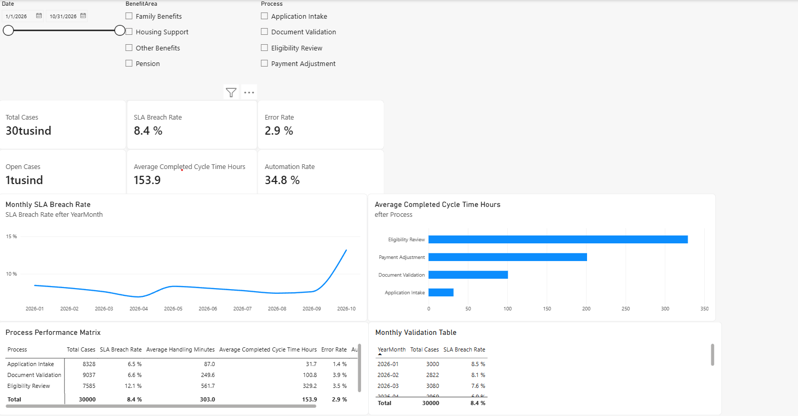
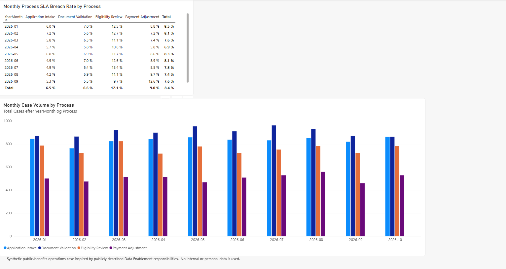

# Public Benefits Operations Enablement Dashboard

**Power BI | Power Query | DAX | Data Modelling | Operational Analytics**

> Synthetic business case inspired by publicly described Data Enablement responsibilities. No internal or personal data is used.

## Project Overview

This project demonstrates how operational data can be transformed into decision support for public-benefits service delivery.

Using 30,000 unique synthetic cases from January to October 2026, the dashboard examines workload, SLA performance, processing time, quality, and automation adoption across four operational processes.

## Business Questions

1. Which processes create the greatest operational pressure?
2. What patterns may explain differences in service performance?
3. Which processes warrant further investigation for improvement or automation?
4. How could the value and quality implications of future interventions be evaluated?

## Dashboard Preview

### Operational Performance Overview

### Process Diagnostics

## Data and Preparation

The project uses synthetic case records across four benefit areas: Pension, Housing Support, Family Benefits, and Other Benefits.

Data preparation in Power Query includes:

- Appending H1 and H2 case files.
- Investigating and removing 25 duplicate case records.
- Merging a channel lookup table.
- Retaining 40 missing channel values as "Unknown".
- Applying appropriate data types and validating the final case count.

## Data Model and KPIs

A date dimension is linked to the case fact table using ReceivedDate.

Core DAX measures include:

- Total and Open Cases
- SLA Breach Rate
- Average Handling Minutes
- Average Completed Cycle Time Hours
- Error Rate and Rework Rate
- Automation Rate

Handling time represents active processing effort; cycle time represents elapsed end-to-end time.

## Initial Findings

The initial analysis indicates:

- **Eligibility Review** has the highest overall SLA breach rate (12.1%) and the highest average handling time.
- **Document Validation** has the largest case volume (9,037 cases).
- **Payment Adjustment** shows increased SLA pressure in September, with a breach rate of 12.6%.
- Monthly performance differs across processes, suggesting the need for targeted investigation rather than a single organisation-wide intervention.

These are descriptive observations, not established causal explanations.

## Decision-Support Approach

The dashboard supports prioritising operational investigation. High workload, processing time, or SLA breaches do not automatically imply that automation is the best solution.

Potential interventions should be evaluated against handling effort, cycle time, SLA compliance, rework, error rates, and adoption.

## Limitations

- All records and scenarios are synthetic.
- Estimated processing costs are illustrative proxies, not actual public-sector costs.
- No real operational stakeholder validation has been conducted.
- The July automation scenario has not yet been evaluated as a causal intervention.
- No verified financial savings or automation value-realisation results are claimed.

## Next Steps

- Investigate the drivers of process-level SLA pressure.
- Evaluate the synthetic July intervention with suitable comparison groups and quality safeguards.
- Assess operational improvements with real stakeholders and constraints where appropriate.

**Project focus:** Business problem → Data preparation → Semantic model → KPI definitions → Analysis → Decision support.
